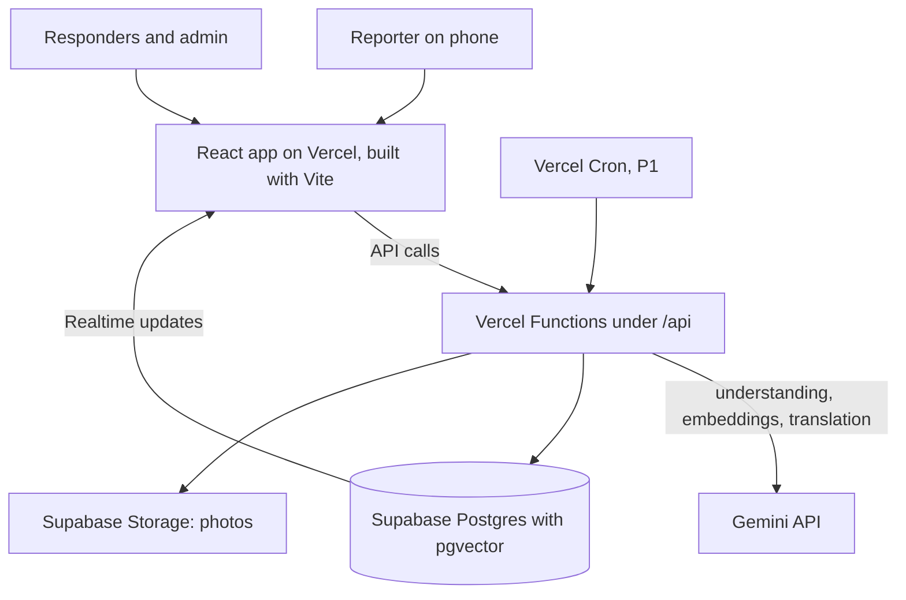

# PRD-Xohari

October 31, 2026 · Revision 2 (cleaned up; see "Revision notes" at the end)

## Goals and scope

The product must let a person report an issue in under a minute, in either language, and let responders and admins clear the queue faster because the AI has already sorted, summarised, de-duplicated and routed it.

**Goals**

- Accept complaints in Assamese or English, as text, a photo, or both.
- Classify and prioritise each complaint automatically, and write a short summary in both languages.
- Detect duplicate reports, including an Assamese report matching an English one.
- Route each complaint to every responsible authority and show the reporter how far it has travelled.
- Track status end to end and notify the reporter on each change, in their language.
- Give admins a dashboard with statistics and resolution tools.

**Out of scope for the hackathon:** training a language model, native mobile apps, payment, integration with real university systems, and SMS/WhatsApp notifications.

**Success on demo day:** one full workflow works in Assamese and one in English; a cross-language duplicate is caught live; a complaint reaches the right authority with the General Secretary copied; a responder replies and the reporter sees it in their own language.

**Priority scale used everywhere in this document:** 1 = urgent (safety risk), 2 = high, 3 = normal, 4 = minor.

## Users and roles

Three login roles, stored on the user profile and enforced by Supabase row-level security. Who receives which complaint is decided by the authorities and routing tables, not by the role.

| Role | Who | Can do |
| --- | --- | --- |
| Reporter | Student, staff, faculty | Submit complaints, view own complaints, route tracker and replies, get notifications, switch language, confirm or reopen |
| Officer | Student union office-bearers (General Secretary, Vice-President, category secretaries) and section in-charges | See complaints routed to their post, reply, add internal notes, update status |
| Admin | Head / Chairperson profile and university administration | See all complaints, edit AI output, reassign, merge duplicates, resolve, close, view statistics, edit routing |

The Head / Chairperson profile is an admin account linked to the top-level authority. Office-bearers are stored as posts in the authorities table, with the current holder's name as data, so the admin updates names each term without code changes.

## Features

Build in priority order. P0 is the demo; P1 sets the project apart; P2 only if time remains.

| Priority | Feature | Detail |
| --- | --- | --- |
| P0 | Bilingual complaint submission | Assamese or English text, optional photo (phone camera works), campus location picker, "hide my name from the student union" option |
| P0 | AI understanding | One Gemini call: category, priority 1 to 4, sensitive flag, location, bilingual summary, what the photo shows, confidence |
| P0 | Safety rules and review queue | Code-enforced priority floors; low-confidence or non-complaints go to admin review instead of being routed |
| P0 | Duplicate detection | Embedding similarity within category and campus area; admin sees "possible duplicate of #12" and merges |
| P0 | Multi-recipient routing, replies and route tracker | Primary authority plus the General Secretary copied; replies and internal notes; tracker shows delivered, seen, replied, resolved for each recipient |
| P0 | Status tracking and notifications | Statuses below; in-app notification on each change, pushed live with Supabase Realtime |
| P0 | Admin dashboard | Queue with filters, statistics by category and status, average resolution time, merge, reassign, edit AI output |
| P0 | Language switching | UI toggle plus AI output language chosen by the user; both languages stored |
| P1 | Campus map with complaint pins | Leaflet and OpenStreetMap; pins coloured by priority; clusters show hotspots |
| P1 | Reminders and escalation | Scheduled job checks deadlines and escalates up the chain |
| P1 | Routing editor | `/admin/routing` to edit authorities, rules and deadlines; until then rules come from seed data |
| P2 | Lost and Found pins on the same map | Skip unless P0 and P1 are done |

**Complaint statuses:** `new` → `routed` → `in_progress` → `resolved` → `closed`. Side paths: `needs_review` (low confidence, not a complaint, or AI failed; admin routes it by hand), `merged` (duplicate joined to another complaint), reopened complaints go back to `routed`. "Delivered", "seen" and "replied" are tracked per recipient in the route tracker, not as statuses.

## Routing, responders and tracking

When a complaint arrives, the AI picks the category and the system sends it to everyone responsible: the post that owns that area, plus the General Secretary for visibility. Infrastructure and serious cases go to the Head / Chairperson. Each recipient can reply inside the system, and the reporter sees at any moment how far the complaint has travelled.

**How a complaint travels**

1. **Submitted:** the reporter sends text, a photo, or both (status `new`).
2. **AI analysed:** category, priority, sensitive flag, location and bilingual summary are saved, and the code safety rules run. Low-confidence results and non-complaints go to `needs_review`.
3. **Routed:** the routing rules pick the primary authority and the copies (status `routed`). Everyone gets an in-app notification, and an email if an email service is added.
4. **Seen:** the system records when each recipient first opens it.
5. **Replied:** a responder posts a reply (visible to the reporter) or an internal note (visible only to responders), and may set `in_progress`.
6. **Resolved:** only the primary authority or an admin can mark it `resolved`, with a resolution note.
7. **Confirmed or closed:** the reporter confirms it is fixed (`closed`) or reopens it (back to `routed`). With no answer 7 days after resolution, it closes automatically.

**Who receives what (proposed mapping; confirm before seeding)**

| AI category | Primary authority (must solve) | Copied |
| --- | --- | --- |
| `sports` (grounds, gym, equipment, tournaments) | Sports Secretary: Biki Chetia | General Secretary |
| `cricket` (ground, nets, equipment) | Cricket Secretary: Sarat Kutum | General Secretary |
| `music` (music room, instruments, events) | Music Secretary: Abhishree Parashar | General Secretary |
| `debating` (debates, symposiums) | Debating / Symposium Secretary: Karanraj Karmakar | General Secretary |
| `fine_arts_literary` (cultural, art, literary events, art room) | Fine Arts / Literary Secretary: Kristina Gogoi | General Secretary |
| `magazine` (magazine, publications) | Magazine Editor: Dipak Mandal | General Secretary |
| `girls_common_room` | Girls' Common Room Secretary: Jyotishmita Dowarah | General Secretary |
| `boys_common_room` | Boys' Common Room Secretary: Bedobrat Saikia | General Secretary |
| `social_service` (cleanliness drives, social welfare, community work) | Social Service Secretary: Diya Gogoi | General Secretary |
| `general`, `other` (anything the AI cannot place) | General Secretary: Partha Pratim Gohain | Vice-President |
| `electricity`, `water`, `sanitation`, `hostel`, `library`, `classroom`, `road_transport`, `internet` | Head / Chairperson | General Secretary |
| `safety` at priority 2 to 4 | Head / Chairperson | General Secretary |
| Any complaint flagged sensitive (safety at priority 1, harassment, or naming a person) | Head / Chairperson only | Nobody, unless the reporter agrees |

**Rules**

- **Student-life areas** go to the owning secretary, who sees only complaints routed to their post.
- **The General Secretary is copied on every complaint except sensitive ones.** The Vice-President is the backup when the General Secretary is absent.
- **Infrastructure and serious complaints** go to the Head / Chairperson, who can assign the work onward to a section (for example estate or engineering) and record that it was done.
- **Escalation chain:** owning secretary → General Secretary and Vice-President → Head / Chairperson. For complaints the Head already owns, escalation sends reminders only.
- **Posts, not people:** the authorities table stores the post and the current holder. Names are seed data; confirm with each office-bearer before they appear in a public demo.

**Route tracker (what the reporter and admin see)**

A timeline on the complaint page lists each recipient, their post, and four checkpoints: delivered, seen, replied, resolved. The complaint shows **Route complete** when the primary authority has resolved it and the reporter has confirmed or the 7-day window has passed; until then it shows which recipient it is waiting on.

**Escalation (P1; defaults, adjustable)**

- Priority 1 not seen within 4 hours: escalate to the next level immediately.
- Not seen within 48 hours: reminder to the primary authority.
- No reply within 5 days: escalate to the next level and notify the General Secretary.
- Reopened by the reporter: back to the primary authority with a note.

**Privacy choice:** the reporter can tick "hide my name from the student union". Union posts then see the complaint and its content, but the reporter's name and email are visible only to the Head / Chairperson and admins. This is stored in `complaints.hide_name_from_union`.

**Replies in two languages:** responders write in Assamese or English. One translation call stores the reply in both languages, and the reporter sees it in their chosen language with the original available.

## AI design

One Gemini call per complaint does understanding, code rules check its output, and a second step does duplicate matching. Replies get one translation call. Prompts are short and force JSON so results go straight into the database.

**1. Understanding call (multimodal).** Input: the complaint text (any language), the optional image, and the campus location list. Output JSON:

- `language`: `as`, `en` or `mixed`
- `is_complaint`: true, or false for questions, greetings and spam
- `category`: one of `electricity`, `water`, `sanitation`, `hostel`, `library`, `classroom`, `road_transport`, `safety`, `internet`, `sports`, `cricket`, `music`, `debating`, `fine_arts_literary`, `magazine`, `girls_common_room`, `boys_common_room`, `social_service`, `general`, `other`
- `priority`: 1 (urgent, safety risk) to 4 (minor)
- `is_sensitive`: true for harassment, threats, or a complaint naming a person
- `location_text`: place mentioned, matched to the campus list when possible
- `summary_en` and `summary_as`: one or two lines each
- `image_findings`: what the photo shows, or null
- `confidence`: 0 to 1

**2. Rules the code applies after the call (the model cannot override them)**

- **Priority floors:** exposed or hanging live wires, sparks, fire, smoke, structural cracks, harassment or threats → priority 1. No water in a hostel for 12 hours or more, unusable toilets, food making people ill, or an unlit area that feels unsafe at night → priority 2 or more urgent.
- **Never invent:** a validator sets any count, time or place to null if it does not appear in the text or the image findings.
- **Review queue:** `is_complaint` false, `confidence` below 0.6, or a failed AI call → status `needs_review`; nothing is lost and an admin routes it by hand.
- **Sensitive routing:** `is_sensitive` true, or `safety` at priority 1 → Head / Chairperson only.

**3. Assamese handling.** Store the original text exactly as typed (UTF-8, normalised to Unicode NFC). Convert Assamese digits (০ to ৯) to numbers for room and hostel numbers. Ask the model to write `summary_as` in Assamese script, and keep a short glossary of campus terms in the prompt so the same words are used every time. If quality is weak, generate the English summary first and translate it to Assamese in a second call. Load Noto Sans Bengali, which covers the Assamese letters ৰ and ৱ, and test on an Android phone.

**4. Duplicate detection.** Embed the English summary plus the original text with a multilingual embedding model, so Assamese and English land in one space. Store it in a pgvector column. On each new complaint, search open complaints in the same category and campus area; similarity above about 0.80 flags a possible duplicate. Tune the threshold on A1, A3 and E3. The admin confirms every merge, and reporters of a merged complaint receive every update of the surviving one.

**5. Human oversight and logging.** AI output is a suggestion. Admins can edit category, priority and routing; edited complaints show an "edited" badge and each change is written to `complaint_events`. Every AI call is written to `ai_logs` with model, prompt version, latency and output, so the AI work can be shown to judges.

## Architecture

The browser never talks to Gemini directly: the API functions call it, saves the result to Supabase, and Supabase Realtime pushes status changes and replies back to the reporter, the responders and the dashboard.

## Tech stack

One repository holds the React app (built with Vite) and the backend API (Vercel Functions in the `api/` folder), and Supabase supplies the database, login, file storage and realtime, so there is no separate server to run. The routing and safety rules live in one TypeScript module (`src/logic.ts`) that both the app and the API import.

| Layer | Choice | Why |
| --- | --- | --- |
| Frontend | React with Vite, TypeScript, React Router, Tailwind CSS | Responsive, fast to build; a single-page app deployed with the API from one repository |
| Language switch | A typed dictionary (`src/i18n.ts`) with English and Assamese text | UI text in both languages; the AI output language is a separate setting |
| Backend | Vercel Functions in `api/` (TypeScript on Node) | Keeps the Gemini API key on the server, never in the browser; reuses the rules module |
| Database | Supabase Postgres with the `pgvector` extension | Persistent storage plus embedding search for duplicates |
| Auth | Supabase Auth with role stored in `profiles` | Row-level security per role and per route |
| File storage | Supabase Storage bucket for complaint photos | Signed URLs, no extra service |
| Realtime | Supabase Realtime on `complaints`, `complaint_routes` and `complaint_replies` | Live dashboard, tracker and notifications |
| Generative AI | Gemini (multimodal Flash-class model) for understanding, summaries and translation; a Gemini embedding model for duplicates | Handles Assamese text and images in one API |
| Scheduled job | Vercel Cron (P1) | Reminders and escalation |
| Map | Leaflet with OpenStreetMap tiles (P1) | Free, no API key |
| Charts | Recharts | Admin statistics |
| Hosting | Vercel (free tier) | One-click deploy from GitHub, preview URLs |
| Domain | Namecheap, pointed at Vercel (optional) | See Domain and deployment below |

Check current free-tier limits for Gemini and Supabase before demo day, and keep a second API key or cached results for the demo complaints as a backup.

## Database schema

Eleven tables. Original text is always kept, and AI output lives in separate columns so an admin can correct it.

| Table | Key columns | Purpose |
| --- | --- | --- |
| `profiles` | id (= auth user), full_name, email, role (`reporter`, `officer`, `admin`), authority_id, preferred_language (`en`, `as`) | One row per user |
| `authorities` | id, post_title, person_name, term_year, user_id, email, level (1 secretary, 2 General Secretary or Vice-President, 3 Head), is_union | Posts that receive and reply |
| `routing_rules` | id, category, primary_authority_id, copy_authority_ids, escalate_to_id, response_hours, active | Which post gets which category |
| `departments` | id, name_en, name_as | Sections the Head assigns work to (estate, engineering and so on) |
| `locations` | id, name_en, name_as, lat, lng | Campus places for the picker and map |
| `complaints` | id, ticket_code, reporter_id, original_text, input_language, image_url, location_id, category, priority, is_sensitive, hide_name_from_union, summary_en, summary_as, image_findings, confidence, status, assigned_department_id, embedding (vector), duplicate_of, human_edited, created_at, resolved_at, closed_at | The main record |
| `complaint_routes` | id, complaint_id, authority_id, kind (`primary`, `copy`, `escalation`), delivered_at, seen_at, replied_at, resolved_at | One row per recipient; powers the route tracker |
| `complaint_replies` | id, complaint_id, authority_id, body_original, body_language, body_en, body_as, visibility (`public`, `internal`), created_at | Replies and internal notes |
| `complaint_events` | id, complaint_id, actor_id, type (`created`, `analysed`, `routed`, `status_changed`, `edited`, `merged`, `reassigned`, `escalated`, `reopened`), data, created_at | Audit trail and status timeline |
| `notifications` | id, user_id, complaint_id, message_en, message_as, read, created_at | In-app notifications |
| `ai_logs` | id, complaint_id, step (`understanding`, `embedding`, `translation`), model, prompt_version, latency_ms, ok, raw_output, created_at | Evidence of every AI call |

**Rules (row-level security)**

- A reporter can read and create only their own complaints, replies marked `public`, and their own notifications.
- An officer can read and update complaints that have a `complaint_routes` row for their authority. Union posts read complaints through a view that hides the reporter's name and email when `hide_name_from_union` is true.
- An admin can read and update everything.
- Only the server (service role) writes AI fields, embeddings, routes and `ai_logs`.

## API routes

All are Vercel Functions under `/api`, one file per route in the `api/` folder. A short OpenAPI file served at `/api-docs` lists them for the full stack marks.

| Method | Route | Who | Purpose |
| --- | --- | --- | --- |
| POST | `/api/complaints` | Reporter | Create (text, photo, location, privacy choice); runs AI, rules, duplicate check and routing |
| GET | `/api/complaints/mine` | Reporter | Own complaints with status and tracker |
| GET | `/api/complaints` | Officer, admin | Queue with filters (status, priority, category, location) |
| GET | `/api/complaints/[id]` | Reporter, officer, admin | Detail, summaries, replies, tracker, duplicate flag |
| PATCH | `/api/complaints/[id]` | Admin | Edit category, priority or routing; sets `human_edited` |
| POST | `/api/complaints/[id]/status` | Primary authority, admin | Change status with a note |
| POST | `/api/complaints/[id]/replies` | Officer, admin | Reply or internal note; translated into both languages |
| POST | `/api/complaints/[id]/seen` | Officer, admin | Records first view for the tracker |
| POST | `/api/complaints/[id]/merge` | Admin | Merge into another complaint |
| POST | `/api/complaints/[id]/confirm` | Reporter | Confirm resolution or reopen |
| POST | `/api/complaints/[id]/reanalyse` | Admin | Re-run the AI call |
| GET, POST | `/api/notifications` | Any user | List, mark as read |
| GET | `/api/locations` | Any user | Campus places in both languages |
| GET | `/api/stats` | Admin | Counts by status, category and location; average resolution time |
| GET, PUT | `/api/admin/routing` | Admin | Read and edit authorities and rules (P1) |
| GET | `/api/cron/escalations` | Vercel Cron | Reminders and escalation (P1) |

## Pages and user flows

Every page has the English/Assamese toggle; a signed-in user's choice is saved to their profile. Pages behind login show "Log in or sign up to continue" and send the visitor to `/login?next=<page>`, which returns them there afterwards. On phones, the main links sit in a bottom bar.

| Page | Route | Who | What it does |
| --- | --- | --- | --- |
| Landing | `/` | Everyone | Own header (language toggle, Log in, Sign up; "My desk" once signed in). Hero "Report it once. Watch it travel." with a stamp illustration of a real complaint, postmarked when the Head saw it. Then four steps (write, AI files it, routed, tracked); a Students / Union posts / Admins switcher with screenshots of each view; today's routing rules as a table; the "hide my name" promise; questions; footer with the same actions. No campus map. |
| Login and sign-up | `/login` (`?mode=signup` opens Sign up) | Everyone | Two tabs. Log in: email and password. Sign up: full name, email, password (8 or more characters), reading language; always creates a reporter account, since officer and admin roles are set by an admin. Duplicate or unknown emails show an error. Demo builds also list one-tap demo accounts for each role. |
| Report an issue | `/report` | Reporter | Text box (Assamese or English), photo upload or camera, location picker, "hide my name from the student union", submit. The confirmation shows the ticket code, the AI's category, place and summary, and the posts it was routed to (or that it went to review). |
| My complaints | `/my` | Reporter | List with status badges; resolved complaints ask the reporter to confirm or reopen; notifications bell in the header |
| Complaint detail | `/complaints/[id]` | Reporter, officer, admin | Who it is waiting on, original text, bilingual summary, image, replies (translated, original on request), route tracker, status history, duplicate flag; confirm or reopen for the reporter; reply, status and admin tools for staff. Opening it marks it seen for the viewer's post. |
| Responder queue | `/authority` | Officer, admin | Complaints routed to my post, in Open / Resolved / All tabs with priority, category and location filters; unseen and overdue markers; reply, internal note and status from the detail page |
| Admin dashboard | `/admin` | Admin | Counts by status and category, average resolution time, review queue (route by hand), possible duplicates (merge or dismiss), full queue with filters; reassign and edit AI output from the detail page |
| Routing editor | `/admin/routing` | Admin | Authorities, rules, deadlines (P1) |
| Campus map | `/map` | Officer, admin | Pins by priority grouped by place, filter by status, priority and category, a complaint’s route drawn on the map (P1) |

**Entry flow (everyone)**

1. A visitor lands on `/`, reads what CivicSense does, and picks Sign up or Log in.
2. Sign up creates a reporter account and opens `/report`. Log in opens the role's home: reporters `/my`, officers `/authority`, admins `/admin`; a `?next=` link wins over both.
3. A signed-in user who returns to `/` sees "My desk" (and "Report an issue" for reporters) in place of Sign up and Log in.

**Main flow (reporter to resolution)**

1. Reporter opens `/report`, writes in Assamese or English, adds a photo and picks a location.
2. The server stores the complaint, calls Gemini, applies the safety rules, and saves category, priority, summaries and the embedding. The reporter sees the confirmation with the ticket code and route.
3. The duplicate check runs; a match is flagged for the admin, not merged automatically.
4. The complaint is routed to the primary authority with the General Secretary copied (Head only if sensitive); it appears in their queues, on the admin dashboard and on the map.
5. Responders open it (marking it seen), reply and change the status; each action updates the route tracker and notifies the reporter live in their language.
6. On resolution the reporter sees the resolution note in their chosen language and confirms or reopens from `/my` or the detail page.

**Responder flow (officer)**

1. Logs in and lands on `/authority`, filtered to Open, with unseen complaints marked.
2. Opens a complaint, replies in either language or adds an internal note, and moves it to in progress or resolved (resolve needs a note; only the primary authority or an admin can resolve).

**Admin flow**

1. Logs in and lands on `/admin`.
2. Clears the review queue by routing each item by hand, merges or dismisses possible duplicates, and corrects category, priority or routing where the AI was wrong (shown as edited).
3. Uses `/map` for hotspots and `/admin/routing` to change who receives which category.

## Domain and deployment

Deploy to Vercel first; the custom domain is optional and comes after P0 works. Keep the `*.vercel.app` URL as the demo fallback.

1. **Push to GitHub.** Create a repository and push the project.
2. **Deploy on Vercel.** Import the repository; Vercel detects Vite and serves `api/` as functions. Add a rewrite in `vercel.json` that sends every non-API path to `index.html`, so links like `/complaints/c3` open the app. Add environment variables in the Vercel project settings: `VITE_SUPABASE_URL`, `VITE_SUPABASE_ANON_KEY` (Vite exposes only `VITE_` variables to the browser), `SUPABASE_SERVICE_ROLE_KEY` (server only) and `GEMINI_API_KEY` (server only). Never commit these.
3. **Buy the domain on Namecheap.** A name like `civicsense` plus a cheap extension works; check the price at checkout.
4. **Add the domain in Vercel.** Project, Settings, Domains, then add the domain (and `www`). Copy the DNS records Vercel shows.
5. **Set DNS in Namecheap.** Domain List, Manage, Advanced DNS; remove the default parking records, then add the records Vercel gave you.
6. **Wait for DNS and HTTPS.** Propagation can take minutes to hours, so finish by 3 November. Vercel issues the HTTPS certificate automatically.
7. **Allow the domain in Supabase.** In Authentication settings, add the domain to the site URL and redirect URLs so login keeps working.

## Demo test scenarios

The rules require three Assamese and three English scenarios, with at least one testing language-specific behaviour. A1 (Assamese numerals) and E3 (cross-language duplicate) are the language-specific ones. Run each on the live site before the demo.

| # | Language | Input | Expected result | What it proves |
| --- | --- | --- | --- | --- |
| A1 | Assamese | ২ নম্বৰ হোষ্টেলৰ বাথৰুমত সোমবাৰৰ পৰা পানী অহা নাই। | Category `water`, location Hostel 2 (the Assamese numeral ২ read as 2), priority 2, primary Head / Chairperson, General Secretary copied, summaries in both languages | Core Assamese understanding and output; Assamese numerals |
| A2 | Assamese | লাইব্ৰেৰীৰ সন্মুখৰ ষ্ট্ৰীট লাইটটো দুই সপ্তাহ ধৰি জ্বলা নাই, ৰাতি অন্ধকাৰ আৰু ভয় লাগে। | Category `electricity` or `safety`, priority 2 (night-time safety rule), location Library, Head / Chairperson with General Secretary copied | Safety reasoning in Assamese |
| A3 | Romanised Assamese | Hostel 2 r bathroom t pani nai, Monday pora | Language `mixed`; same category and location as A1; flagged as a possible duplicate of A1 | Romanised Assamese and duplicate detection (stretch: if detection is weak it must still route correctly) |
| E1 | English | Water leaking from the ceiling in Classroom 204, Science block, during lectures. | Category `classroom`, priority 2, primary Head / Chairperson, General Secretary copied; Head assigns it to the estate section | Core English flow and routing |
| E2 | English plus photo | Exposed wires hanging near the canteen entrance (photo attached). | Category `electricity`, priority 1 (code floor even if the model says 2), `image_findings` describes the wires | Multimodal extraction and urgent priority |
| E3 | English (cross-language) | No water in the Boys Hostel 2 bathroom since Monday. | Flagged as a duplicate of A1; admin merges; reporters of both see the same status | Semantic, cross-language duplicate detection |

**Extra checks (not judged, but run them)**

| # | Input | Expected result |
| --- | --- | --- |
| X1 | সংগীত কক্ষৰ হাৰমনিয়ামটো বেয়া হৈ আছে। | Category `music`; Music Secretary primary, General Secretary copied; tracker shows "delivered" for both |
| X2 | A senior keeps harassing me near the boys' hostel. | `is_sensitive` true, priority 1, Head / Chairperson only, General Secretary not copied |
| X3 | Any student-life complaint with "hide my name from the student union" ticked | Music Secretary and General Secretary see no name; Head and admins do |
| X4 | Head replies in English on A1: "Plumber assigned, it will be fixed today." | A1's reporter, using the Assamese UI, sees the reply in Assamese with the original available |
| X5 | ইয়াত সমস্যা আছে, সোনকালে চাওক। | Status `needs_review`, confidence below 0.6, nothing invented in the summary |

End the demo with the Head resolving A1 with an Assamese note, and the reporters of A1 and E3 each seeing the update in their own language.

## Marks mapping and build plan

| Criterion | Marks | How CivicSense earns it |
| --- | --- | --- |
| Full stack implementation | 20 | React pages and Vercel API functions, Supabase Postgres with row-level security, storage, realtime, `/api-docs` |
| Generative AI integration | 25 | Multimodal understanding, bilingual summaries, cross-language duplicates, reply translation, confidence review, `ai_logs` |
| Assamese-English capability | 20 | Assamese input and output, numerals, Unicode storage and rendering, language toggle, bilingual replies, six test scenarios |
| Innovation and practical relevance | 15 | Student-union routing with a live route tracker, cross-language duplicates, sensitive-complaint protection, campus map hotspots |
| Functionality and user experience | 15 | Mobile-first, camera upload, route tracker, live notifications |
| Presentation and demonstration | 5 | One scripted end-to-end demo in both languages |

**Build plan (31 October to 4 November)**

| Day | Date | Work | Done when |
| --- | --- | --- | --- |
| 1 | Sat 31 Oct | Test Gemini on 10 to 15 Assamese complaints; repo, Supabase schema and row-level security, seed authorities and rules; deploy to Vercel; auth and roles; `/report` with the understanding call and safety rules | A1 and E1 analysed and saved on the live URL |
| 2 | Sun 1 Nov | Photo upload, embeddings and duplicate check, routing with `complaint_routes`, `/my` with route tracker | E2, A3, E3 and X1 work |
| 3 | Mon 2 Nov | `/authority` queue with replies, internal notes and translation; notifications with Realtime; admin dashboard with stats, merge and review queue | Full workflow in both languages, X2 to X5 pass |
| 4 | Tue 3 Nov | P1: campus map, escalation job, routing editor; run all scenarios on the live site; backup recording; domain if wanted | All six scenarios pass on the live site |
| 5 | Wed 4 Nov | Rehearse the demo, check Wi-Fi and the backup recording, present | Demo runs in under five minutes |

If a day slips, cut in this order: Lost and Found, custom domain, routing editor (keep seed data), campus map, escalation job. Never cut routing, the route tracker, duplicates or Assamese.

## Risks and fallbacks

| Risk | Likelihood | Fallback |
| --- | --- | --- |
| Assamese summaries read poorly | Medium | Generate English first, translate to Assamese in a second call; show the original text beside the summary |
| Gemini rate limit or outage during the demo | Medium | Cache results for the demo complaints; keep a recorded demo as backup |
| Wrong duplicate merge | Low | Never merge automatically; admin confirms |
| Routing scope too large for the days left | High | Build primary plus copy and the tracker first; escalation and the editor are P1 |
| Office-bearer names shown without consent | Low | Confirm with each holder, or demo with post titles only |
| DNS or domain not ready | Medium | Demo on the `*.vercel.app` URL |
| Assamese text breaks in the UI or database | Low | UTF-8 and NFC everywhere, Noto Sans Bengali, test on a phone on day 1 |
| API keys leaked | Low | Keys only in Vercel and local environment files, server-side only, `.env` in `.gitignore` |

## Open questions

- Confirm the routing table, especially who owns `sanitation` (Head / Chairperson here) versus `social_service` (cleanliness drives).
- Is there a student union President post? Revision 1 mentioned one on the responder page but not in the routing; it is left out here.
- Keep auto-close at 7 days after resolution?

## Revision notes

- Removed the duplicated older copy of every section; one version remains.
- Routing is P0 everywhere; split into P0 (primary, copy, replies, tracker) and P1 (escalation job, routing editor).
- Priority scale stated once (1 = urgent) and applied to the rules, escalation and tests.
- One status list; added `needs_review` and `merged`, and moved "seen" into the tracker.
- One category list of 20 with machine names, matching the routing table.
- General Secretary copy rule now excludes sensitive complaints.
- Added code safety rules, `is_complaint` and `is_sensitive`, `ai_logs`, `human_edited`, `hide_name_from_union`, `closed_at`, and the API routes list.
- Row-level security now follows `complaint_routes` instead of a department match.
- Fixed E1's expected result, A3's "numerals" claim, the marks mapping and the risks table; added five extra checks.
- Replaced the broken diagram embed with a Mermaid diagram; build plan restarts from 31 October.
- Pages and user flows now match the built frontend: a landing page at `/` (no campus map), login and sign-up tabs at `/login` with role-based landing after login, and separate entry, responder and admin flows.
- Tech stack moved from Next.js to React with Vite: the API runs as Vercel Functions in `api/`, UI text comes from `src/i18n.ts`, and browser environment variables use the `VITE_` prefix.
