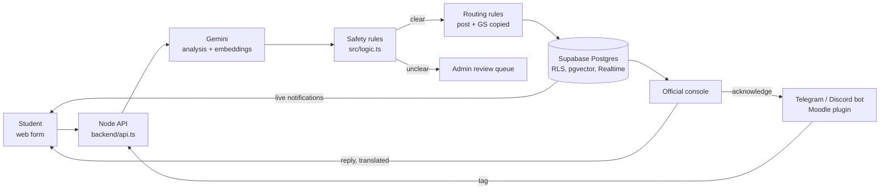

# Xohari — Smart Campus Redressal

**Dibrugarh University · Game of Codes, ANAZORI v16.0 · Problem statement PS-04**

Students report campus problems in **Assamese or English**. AI sorts, summarises, de-duplicates and routes each one to every office responsible. Officials resolve it from one console, and the student watches it travel like a parcel.

> Codename in the repository: **CivicSense** (also the name of the chat bot).
>
> **Live demo:** _add the link once deployed ([docs/DEPLOY.md](docs/DEPLOY.md))_.

---

## The problem

On campus, a broken tap, a dead Wi-Fi router or a harassment case usually ends up as:

- a paper application that waits on someone's desk, or
- a message in a WhatsApp group that everyone sees and nobody owns.

Students don't know **who** is responsible, **whether** anyone saw it, or **when** it will be fixed. Officials, in turn, get scattered, duplicated, half-described reports, many of them in Assamese, with no priority order.

## Our solution

| For students | For officials |
|---|---|
| Report in under a minute: text, photo or both, in Assamese or English | A queue that arrives **already sorted**: category, priority, bilingual summary |
| Pick the place on a campus map | **Duplicates** flagged, even an Assamese report matching an English one |
| A **route tracker** for each office: delivered → seen → replied → resolved | Replies are translated automatically into the student's language |
| Live notifications; confirm the fix or reopen it | Statistics, routing editor, review queue for unclear cases |
| Raise an issue straight from a **Telegram, Discord or Moodle** group by tagging the bot | Issues discussed in groups reach the right office **before** anyone files a complaint |

## Key features

1. **Bilingual AI analysis (Gemini 2.5 Flash).** One call reads the text and the photo. It returns the category, priority 1–4, a sensitive flag, the location, an English and Assamese summary, and a confidence score.
2. **Safety rules in code, not in the prompt.** Code enforces priority floors (for example, exposed wires are always urgent) and never accepts invented details. Low-confidence results and non-complaints go to a human review queue instead of being routed. If Gemini is down, the built-in keyword rules take over, so the app never stops.
3. **Cross-language duplicate detection.** Multilingual embeddings (pgvector) catch "হোষ্টেল ৩ ত পানী নাই" and "No water in Hostel 3" as the same issue. The admin merges them in one click.
4. **Multi-recipient routing with a route tracker.** Each complaint goes to the post that owns the category, with the General Secretary copied. The student sees every recipient's checkpoints. Overdue complaints escalate automatically.
5. **Privacy by design.**
   - "Hide my name from the student union": union posts see the issue but not the reporter.
   - Sensitive cases (harassment, threats) go to the Head only.
   - Row Level Security in Postgres decides who can read what, not the frontend.
6. **Agent tag: complaints from group chats.** A student tags the bot in a Telegram or Discord group, or writes `@CivicSense` in a Moodle forum post. The bot analyses the message and routes it as a *signal*. When another affected student replies "+1", it reaches the office. The official answers, and the bot replies in the group for everyone to see. Guardrails:
   - The bot reads only messages meant for it.
   - Only linked student accounts can report.
   - Daily limits apply.
   - Sensitive issues are never answered publicly.
7. **Developer monitoring.** The console's System page shows:
   - Gemini calls, tokens and estimated cost;
   - latency and failure rates, and how often the fallback took over;
   - server errors and chat-bot health.

## How it works



## Demo walkthrough (3 minutes)

1. **Assamese report:** a student files "হোষ্টেল ৩ ত কালিৰ পৰা পানী নাই" with a photo. AI files it as *water*. The tracker shows *Head / Chairperson* and *General Secretary* (copied), both "delivered".
2. **Cross-language duplicate:** a second student files "No water in Hostel 3 since yesterday". The console flags it as a possible duplicate, and the admin merges it.
3. **Reply in the student's language:** the official replies in English. The student reads it in Assamese, and the tracker turns "replied".
4. **Sensitive report:** a harassment report reaches the Head only. The union never sees the reporter.
5. **Agent tag:** in a Telegram group, `@CivicSenseBot no Wi-Fi in the library`, then a second student replies "+1". The signal appears on the console. The official acknowledges it, and the bot answers in the group.
6. **System page:** the AI calls, tokens and cost of the whole demo.

## Tech stack

| Layer | Technology |
|---|---|
| Frontend | React 18, TypeScript, Vite; GSAP, Lenis and Framer Motion for motion; canvas campus map |
| Backend | Node 22 API (`backend/api.ts`); a single bundled function on Vercel |
| Database and auth | Supabase: Postgres with Row Level Security, Auth, Realtime, pgvector |
| AI | Google Gemini 2.5 Flash (analysis, translation), `gemini-embedding-001` (duplicates); keyword-rule fallback |
| Media | Cloudinary (signed uploads, private evidence files) |
| Chat integrations | Telegram Bot API (long polling), Discord Gateway, Moodle plugin `local_civicsense` (PHP) with Moodle web services |
| Quality | 53 automated tests (`npm test`) plus a 43-check live test against the real database (`npm run test:live`) |

## Run it locally

Requires **Node 22.6+** and a Supabase project.

```bash
npm install
cp .env.example .env.local   # fill in the Supabase and Cloudinary keys (Gemini optional)
npm run dev                  # http://localhost:3000, admin console at /admin
```

`.env.local` is git-ignored. Never put real keys in `.env.example` or in code. Without a complete `.env.local`, the pages still load, but every `/api/*` call returns "Server not configured".

### Database setup (once, in the Supabase SQL Editor)

1. Run `backend/schema.sql`.
2. Create the admin login under **Authentication → Users → Add user**. Then set its email in `v_admin_email`, in the last block of `schema.sql`, and run that block again.
3. Turn **Confirm email** off (Authentication → Providers → Email). Student sign-up needs it off.
4. Run the migrations in order. Each one is additive and safe to re-run:

   | Migration | Adds |
   |---|---|
   | `backend/migrations/001_ai_routing_tracker.sql` | AI analysis, routing to posts, route tracker, replies, notifications. **Run it again whenever you re-run `schema.sql`.** |
   | `backend/migrations/002_chat_signals.sql` | Agent tag: chat account links, signals |
   | `backend/migrations/003_observability.sql` | Token counts and the server-error log for the System page |

5. Link posts to official accounts by email, so officials see what is routed to them:

   ```sql
   update public.authorities set email = 'gs@dibru.ac.in' where post_key = 'general_secretary';
   update public.authorities set email = 'admin@dibru.ac.in' where post_key = 'head';
   ```

### Optional features

- **Gemini:** set `GEMINI_API_KEY`. Without it, the keyword rules analyse everything. To see an estimated cost on the System page, set `GEMINI_PRICE_INPUT_PER_M` and `GEMINI_PRICE_OUTPUT_PER_M` (US dollars per million tokens).
- **Telegram:** create a bot with [@BotFather](https://t.me/BotFather) and set `TELEGRAM_BOT_TOKEN`. Keep the default privacy mode. `/report` always works; plain @mentions may need the bot to be a group admin.
- **Discord:** create an application and bot in the [Developer Portal](https://discord.com/developers/applications) and set `DISCORD_BOT_TOKEN`. Invite the bot with the `bot` scope and the *Send Messages* and *Read Message History* permissions. It needs no privileged intents.
- **For both bots:** set `PUBLIC_SITE_URL` (where students open their account link) and `CHAT_BOTS=true`. Set `CHAT_BOTS=true` in **one** process only. The bots need a long-running process (`npm run dev`, `preview` or `server`), not a Vercel function.
- **Moodle:** install [`moodle/local/civicsense`](moodle/local/civicsense/README.md) on the Moodle site, then set `MOODLE_URL`, `MOODLE_TOKEN` and `MOODLE_SECRET`. Moodle pushes posts to CivicSense, so this works on Vercel too.

### Commands

| Command | What it does |
|---|---|
| `npm run dev` | Dev server with the API at http://localhost:3000 |
| `npm run build` | Type-checks, then builds `index.html` and `admin.html` into `dist/` |
| `npm run preview` | Serves the production build **with** the API (needs `.env.local`) |
| `npm run server` | API only, on port 3001 (no static files) |
| `npm test` | Tests for the access rule, the PRD routing/safety rules (against its demo scenarios) and the AI module |
| `npm run test:live -- <url>` | Live test of the database rules and the complaint flow against the real Supabase project, through a running dev server (default `http://localhost:3000`). Uses temporary `zz-migration-test-*` accounts and always deletes them again |

Without a complete `.env.local` the pages still load, but every `/api/*` call returns a "Server not configured" error.
